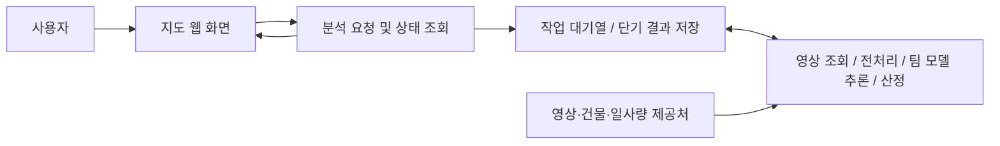

# SolarCast 제품 요구사항 (PRD)

이 문서는 **최종 서비스**를 정의한다. 현재 Task 1에서 구현한 범위는 마지막 절에 따로 표시한다. 모델과 연동 계약의 상세는 [MODEL_SPEC.md](MODEL_SPEC.md)를 참조한다.

## 1. 서비스와 사용자

| 과제 검토 후보 | AI가 주는 가치 | 선택 판단 |
|---|---|---|
| SolarCast: 옥상 태양광 입지 분석 | 항공사진에서 기존 패널과 옥상 제약을 찾고, 설치 가능한 공간과 예상 발전량을 제시한다. | 기존 영상·라벨·건물 자료와 연구 코드로 시작할 수 있고, 단일 지도 분석 흐름으로 결과를 활용할 수 있어 **선택**. |
| Word Note · 영단어 복습 | 예문 빈칸 퀴즈와 단어 난이도에 따른 간격 반복 복습을 제공한다. | 기존 시안은 예문과 난이도를 외부 LLM API로 생성하므로 팀이 학습한 모델이라는 과제 요건에 맞지 않는다. 난이도 모델을 직접 학습하려면 새 라벨 데이터가 필요해 **보류**. [Word Note 시안](https://word.nemovim.dev) |

건물 관리자와 에너지·공간 분석 담당자가 현장 조사 전에 여러 옥상의 잠재량을 같은 기준으로 비교한다. 서비스가 제공하는 것은 영상과 모델에 근거한 **설치 후보 면적 및 발전량 추정치**이며, 구조 안전·시공 가능 여부나 발전량 보증이 아니다.

## 2. 주 사용 흐름

1. 지도에서 국내 위치를 이동하거나 검색하고, 지도 중심과 반경(250 m, 500 m, 1 km)으로 구역을 지정한다.
2. 필요하면 날짜·시각(한국 시간, 5분 단위 또는 절기 프리셋)을 고른다. 이 설정은 순간 음영 표시 기준이고, 연간 발전량은 연간 일조 조건으로 계산한다.
3. **분석 시작**을 누르면 선택 구역을 고정하고 진행 상태(영상 확보 → 추론 → 면적·발전량 산정)를 표시한다. 분석용 영상은 지도 배경과 별도로, 요청 시점에 제공처에서 사용할 수 있는 최신 자료를 조회한다.
4. 지도에서 건물·음영·기존 패널·신규 설치 후보를 구분하고, 건물 상세와 구역 합계, 예상 연간 발전량 순위를 확인한다. 순위를 선택하면 해당 건물로 이동한다.
5. 다른 위치나 범위를 분석하면 새 요청을 시작한다. 아직 분석하지 않은 위치에 이전 결과를 새 결과처럼 덮어 표시하지 않는다.

## 3. 기능 요구사항

| ID | 최종 필수 기능 | 동작 |
|---|---|---|
| FR-1 | 국내 지역 확장 | 나주 고정 없이 국내에서 탐색하고 분석을 요청할 수 있다. 검증과 데이터 이용 조건을 충족한 복수 권역에서 실제 분석을 제공하고, 미지원·부분 지원 지역을 지도에서 표시한다. 건물 레이어 및 지상층수·높이 기반 3D 보기와 상세 팝업을 제공한다. 높이 대체값이 쓰이면 구분한다. |
| FR-2 | 요청 시 영상 조회 및 모델 추론 | 사용자가 고른 구역의 최신 이용 가능 영상과 건물을 확보하고 전처리한 뒤 팀이 학습·파인튜닝한 모델을 요청 단위로 실행한다. 관측일(알 수 없으면 미상)과 조회 시점을 구분한다. 실시간 촬영을 뜻하지 않는다. 검증된 입력·모델 버전에 한해 캐시가 가능하되 다른 위치의 사전 계산 결과로 대체하지 않는다. |
| FR-3 | 기존 패널과 설치 가능 영역 | 모델이 찾은 기존 패널을 별도 레이어로 표시하고 탐지 신뢰도 필터를 제공한다. 지붕 경계·장애물·기존 패널·이격 기준을 적용해 신규 설치 가능 폴리곤과 면적을 산정한다. 표시용 신뢰도 필터 변경이 산정 기준을 조용히 바꾸지는 않는다. |
| FR-4 | 일조·그림자 분석 | 선택 시각의 태양 고도·방위각과 건물 그림자를 갱신한다. 옥상 면적의 10% 이상이 가려진 경우 음영 상태를 구분한다. 주변 건물 자료가 부족한 경우 불완전함을 알린다. |
| FR-5 | 연간 발전량 추정 | 설치 후보에 모듈을 배치하고 연간 유효 일조율 70% 이상 배열을 집계한다. 건물별 설치 가능 면적(㎡), 유효 모듈 면적(㎡), 유효 일조율, 용량(kW), 발전량(kWh/년)을 구분하고, 구역 합계와 순위를 제공한다. NASA POWER 수평면 일사량, 400 W 모듈, 성능계수 0.8을 초깃값으로 명시한다. |
| FR-6 | 상태와 한계 안내 | 대기·진행·완료·유효 후보 없음·데이터 누락·실패를 구분한다. 계산에 꼭 필요한 데이터가 없는 결과는 0이나 예시 숫자로 대신하지 않는다. 재시도 또는 범위 축소를 안내한다. |

선택 기능은 결과 내보내기와 두 구역 비교다. 회원가입·공유 분석 이력·실시간 센서·시공 견적·구조 안전 판정은 제외한다.

## 4. AI의 역할과 결과 활용

사용자는 이미지를 올리는 대신 지도 좌표·범위를 지정한다. 서버가 지리참조 RGB 영상을 준비하고, 옥상과 장애물 마스크 및 기존 패널 인스턴스의 마스크·박스·신뢰도를 얻는다. 팀이 파인튜닝할 주 모델은 **옥상·장애물 분할 모델**이며, 기존 패널에는 팀의 NLR RTMDet-Ins-X 패널 모델을 사용한다. 후처리가 마스크를 지도 좌표로 돌려놓고 면적·모듈 배치·음영·연간 발전량을 계산한다. 패널 탐지 결과를 설치 가능 면적이라고 표시하지 않는다.

## 5. 화면 구성

- **지도**: 넓은 지도에서 위치·범위를 선택하고 영상 출처·촬영일과 레이어 범례를 확인한다. 위성·항공 배경 위에 3D 건물을 그리고, 기존 패널·설치 가능 영역·옥상 음영은 해당 건물 옥상 높이에 맞춰 표시한다. 건물을 누르면 지도 위 팝업에서 해당 건물의 분석값을 확인한다. 모바일에서도 큰 지도와 별도 설정 구역을 제공한다.
- **분석 설정**: 범위, 기준 날짜·시각, 레이어, 신뢰도, 분석 실행과 단계별 상태.
- **결과**: 설치 가능 면적·설치 용량·예상 연간 발전량 요약, 건물별 순위, 데이터 제한과 산정 가정. 빈 상태와 실패를 별도로 표시한다. 결과 폴리곤은 선택 구역과 같은 좌표계로 지도에 겹쳐 표시한다.

## 6. 기술 구성과 데이터 저장

Next.js·TypeScript·Tailwind CSS 웹을 Vercel에서 호스팅하고 MapLibre GL JS로 VWorld WMTS 항공사진(원본 타일 최대 z19)과 3D 건물을 표시한다. 실제 추론은 Python/PyTorch 기반 별도 작업 환경에서 수행한다. 웹이 추론 작업 등록과 상태 조회를 중계하고 WGS84 GeoJSON과 발전량 통계를 그린다. 상호 계약은 [모델 명세](MODEL_SPEC.md#5-시스템-구조와-인터페이스)에 정의한다.

- **배경 항공사진**: VWorld `Satellite` WMTS에서 지도 타일을 조회한다.
- **지도용 건물**: VWorld 2D 데이터 API 2.0의 도로명주소 건물(`LT_C_SPBD`)에서 현재 화면 범위의 건물 외곽선과 속성을 GeoJSON으로 조회한다. VWorld 3D 모델을 받는 것이 아니라, 지도에서 2D 외곽선을 높이만큼 올려 그린다. 제공 높이가 없으면 지상층수 × 3.3m, 층수도 없으면 표시용 15m를 적용하고 팝업에서 출처를 구분한다. 표시용 높이는 분석 결과가 아니다.
- **인증**: 두 조회는 웹 서버에서 수행하고 `VWORLD_KEY`는 브라우저·저장소에 노출하지 않는다. URL 제한 키를 사용하는 배포 환경에는 브이월드에 등록한 서비스 URL을 `VWORLD_DOMAIN`에 설정한다. 서버는 이 값을 건물 데이터 요청의 `domain` 파라미터로 전달한다. 브라우저가 SolarCast에 보내는 요청에는 키나 `domain`을 넣지 않는다.

사용자 계정과 분석 이력 DB는 만들지 않는다. 최종 서비스는 비동기 작업에 필요한 요청 구역·상태·결과·출처 버전만 일시 저장하고, 기본 24시간 뒤 만료하도록 설계한다. 이 정보는 공개 결과 목록에 노출하지 않는다. 영상 캐시는 제공처가 허용하는 경우에만 보관한다. Task 1에는 저장소와 작업 대기열이 없다.

## 7. 배포와 주요 위험

- **제출**: 소스와 두 명세를 GitHub에 두고 Vercel의 프로젝트 루트를 `5_web_service`로 설정한다. 과제 제출 시 로그인하지 않은 브라우저에서 GitHub와 배포 URL의 접근을 확인한다. 자세한 절차는 [웹 README](5_web_service/README.md)에 있다.
- **지도 배포 확인**: Vercel 운영 환경에 인증 설정을 저장한 뒤 재배포한다. 항공사진과 건물은 별도 요청이므로, 배포 주소에서 항공사진이 표시되는 것과 건물 데이터가 있는 검증 구역에서 실제 3D 건물·팝업이 열리는 것을 각각 확인한다. 건물 조회 실패를 데이터 없음으로 처리하거나 시연 건물로 대체해 성공으로 표시하지 않는다.
- **연산·응답 시간**: 학습과 추론의 기본 환경은 학교 Backend.AI의 GPU 세션이다. 세션이 실행 중일 때 작업자가 큐에서 요청을 가져간다. 세션이 없으면 대기 상태를 표시한다. 소규모 CPU 추론은 지연과 메모리를 측정한 뒤 대체 수단으로 채택할지 결정한다. Vercel은 웹과 API 중계를 맡는다.
- **영상·권역**: 브이월드 영상은 지도 표시, 학습용 저장·추론, 원본 공개·재배포의 이용 근거를 용도별로 확인해 기록한다. 원본 타일의 학습용 저장과 공개에 대한 승인은 아직 확보하지 못했으며, 용도별 처리 계획은 [모델 명세](MODEL_SPEC.md#1-데이터와-조사-근거)에 정리했다. 촬영일·해상도·가용성을 확인하고 미지원 지역을 명시한다. 지붕 위치 오차, 층고 대체, 옥탑·경사·구조 정보의 한계, 학습 지역과 타 지역 차이를 결과에 명시한다.

## 8. 최종 완료 기준

1. 빛가람동 외 독립 검증 권역을 포함해 두 곳 이상의 국내 지원 지역에서 새 구역을 선택하면 요청 기반 실제 모델 분석이 수행된다. 미지원 구역은 지원 범위 안내를 표시한다.
2. 요청 구역·영상 출처·조회 시점·촬영일 상태 및 추론 진행 상태를 확인할 수 있다. 이미지 없음, 부분 누락, 추론 실패에서 미계산 결과를 실제 값처럼 표시하지 않는다.
3. 지도에서 기존 패널과 설치 가능 영역이 구분되고, 레이어·탐지 신뢰도·날짜와 시각 조작의 결과가 각 대상에 반영된다. 건물 순위에서 지도 이동과 건물 상세 조회가 된다.
4. 검증용 구역에서 면적·용량·발전량과 건물별 순위가 명시한 산정 규칙 및 단위와 일치한다. 70% 미만 일조 배열은 유효 발전 집계에 포함되지 않는다.
5. 독립 권역 검증과 지연·자원 시험을 기록하고, 강의 담당자가 GitHub 및 Vercel 제출 링크에서 문서와 서비스를 열 수 있다.

## 9. Task 1 구현 범위 — 별도 화면 시안

국내 위치 탐색 지도, 범위·일조 기준 시점 컨트롤, VWorld 배경 항공사진과 지도용 건물 조회를 제공한다. 브이월드 연동이 정상인 경우 줌 16.5 이상에서 실제 건물을 조회하고, 지도 3D 버튼으로 확대·기울이기, 건물 클릭으로 속성 확인을 할 수 있다. 시연 모드에서는 가상 건물 1동에 옥상 레이어와 고정 예시 수치를 표시하며 실제 건물과 구분한다. **분석 시작**은 실제 요청을 보내지 않고 미구현 안내를 표시한다. 분석용 영상 조회·전처리·추론·음영/발전량 계산 및 이력 저장은 연결하지 않는다. 위 완료 기준은 이 화면 시안이 아니라 최종 제품의 기준이다.
